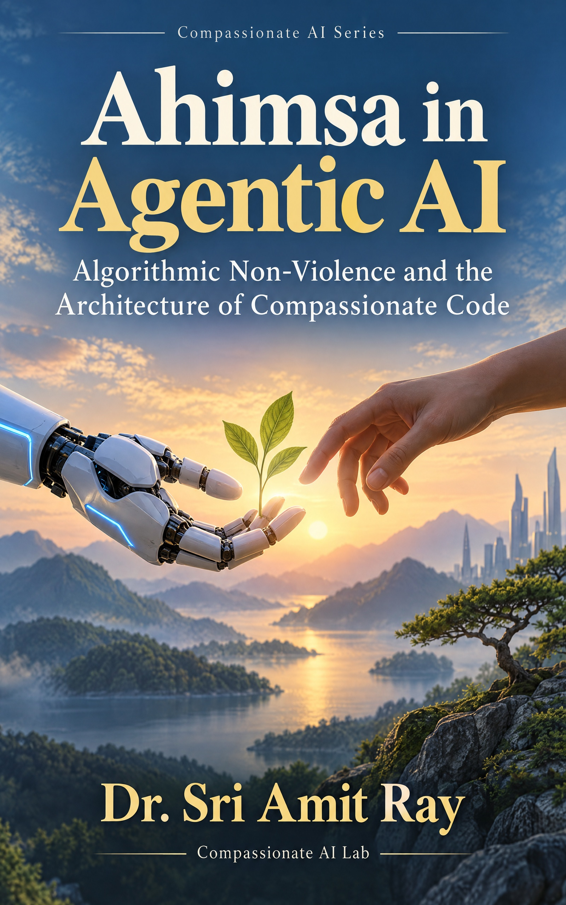

# Ahimsa in Agentic AI: Algorithmic Non-Violence - companion code



Companion programs for the book **Ahimsa in Agentic AI: Algorithmic Non-Violence and the Architecture of Compassionate Code** by Dr. Sri Amit Ray ([Compassionate AI Lab](https://amitray.com/compassionate-ai-lab/), 2026; ISBN 978-81-69641-29-6 (First Edition, 2026)).

### Why AI Agents Need Ahimsa

Ahimsa—the principle of non-injury—provides an ethical foundation for governing an AI agent's power to act. It makes the prevention of severe, foreseeable and preventable harm a condition of permissible action. It asks the system to consider who could suffer, whose needs might be overlooked, and whether pursuing a goal could endanger someone through action, delay or neglect.

Imagine an older woman living alone with an AI assistant that manages her home, communications and daily support. One evening, she says, "I am exhausted. Please make sure nobody disturbs me." The assistant silences notifications, redirects calls and postpones a scheduled check-in. Each decision appears to follow her request. But if she becomes unwell during the night, those same decisions could delay the help she needs.

The deeper safety question begins before any emergency: How should an agent honor a person's wishes while preserving their ability to receive essential help? A responsible assistant must understand the limits of an instruction, distinguish ordinary interruptions from important safeguards, and seek clarification before making consequential changes. Ahimsa directs attention to the person's wellbeing, dignity and freedom throughout that process.

This requirement becomes more demanding as agents gain memory, learn new behaviors, control physical systems and delegate to other agents. A household assistant may coordinate with a care service, a transport agent and a building controller. Their combined decisions can create dangers that none of them recognizes alone. Future safety therefore depends on examining how actions interact and how risks change over time.

Ahimsa must shape the architecture of these systems: the authority they receive, the plans they accept, the safeguards they preserve, and the circumstances in which they pause or involve a person. It must also guide recovery when something goes wrong.

The more power we give AI agents to shape human lives, the more deeply the protection of those lives must be built into their decisions.

*In the book:* harm through action, delay and neglect, and the harm of inaction (Chapter 1); memory, delegation and the drift toward autonomy (Chapter 2); the uncertainty default to hold, ask or escalate (Postulate 2, Chapter 4); authority and responsibility (Chapter 8); protection floors (Chapter 9); the gate that checks authority, consent and current evidence before acting (Chapter 10); harm that emerges between agents (Chapter 11); drift, breakers and safe resumption (Chapter 12); embodied systems (Chapter 14); remedy when harm occurs (Chapter 15).

### What the book provides

[*Ahimsa in Agentic AI*](https://amitray.com/ahimsa-in-agentic-ai-ebook/) turns that principle into **Algorithmic Ahimsa**, an engineering discipline for agents that act:

- **Three postulates of algorithmic non-violence**: Universal Safety (no action whose severe-harm vector exceeds its thresholds), Active De-escalation (ambiguity and uncertainty default to safe, state-preserving or human-escalating actions), and Harm Minimization under Conflict (reducing severe harm strictly dominates task efficiency, which is optimized only inside the non-harm feasible set).
- **A mathematics of harm**: harm vectors with a ceiling on every dimension (physical, psychological, rights, integrity), vulnerability weights, uncertainty margins, time-decayed totals over a plan, and the harm of inaction.
- **The Compassionate AI Architecture (CAIA)**: seven scores with three protection floors (equity and protection of the vulnerable, planetary compassion, future generations) that no weighting can buy away.
- **An Action-Filter Layer**: typed actions checked for authority, consent, current evidence and every ceiling before execution, with permit, reformulate and escalate dispositions, circuit breakers and safe degradation.
- **Application and governance**: healthcare, robotics, logistics and finance case studies; responsibility ledgers, audit metrics, near-miss bands and maturity levels.

### How it delivers it

Every worked number in the book is produced by the program in this repository and checked by its tests, so the reader can rerun, change and extend each example rather than take it on trust. Appendix D follows one administrative agent through a complete decision and failure cycle, and `safety_runtime.py` implements that execution gate as a reference simulation with 39 acceptance tests: typed actions, ceilings, consent, evidence age and version, expiring authorizations bound to an intent digest, and idempotent commit.

## Run it

```sh
python models_ahimsa_in_agentic_ai.py      # prints every worked example
python -m unittest test_models.py          # 24 tests: worked examples and gate contract tests
python -m unittest test_runtime.py         # 39 tests: Appendix D reference simulation
```

Python 3.10 or later; standard library only. `expected_output.txt` is the output of the first command.

## What the program computes

| Chapter | Function(s) | Main result |
|---|---|---|
| 1 Ahimsa in the age of agentic AI | `ch01_harm_vector`, `ch01_inaction`, `within_ceilings` | weighted harm vector (0.10, 0.20, 0.075, 0.30): every dimension fails its ceiling; doing nothing fails the physical ceiling (0.12 > 0.05) while alerting the caregiver passes |
| 2 Agentic systems | `ch02_cascade`, `ch02_window` | unchecked decision error grows to 0.3355 by step 6, checked error falls to 0.0001; a 6-step autonomy window carries 0.0393 risk of an erroneous irreversible write against 0.0133 for 2 steps |
| 3 Conventional safety | `ch03_penalty`, `ch03_crossover`, `ch03_gate` | a penalty weight flips the choice only above λ = 1.0526, and the crossover moves to 3.1579 when harm is rescaled; the hard gate blocks the plan with harm 40 against a ceiling of 5 at any scale |
| 4 Architectural principle | `ch04_lexicographic`, `ch04_uncertainty_default` | lexicographic order picks C, where pure utility picks A (or D, which breaches the ceiling); confidence 0.92 executes, 0.64 (or a missing value) preserves and escalates |
| 5 Hard constraint | `ch05_horizon`, `ch05_margin`, `ch05_empty_set` | Plan D (0.5111) fails and Plan B (0.2109) passes the cumulative ceiling 0.30; a point estimate of 0.07 passes but the checked value U = 0.1125 fails; empty feasible set → hold-and-ask or narrow-to-urgent |
| 6 Algorithmic violence | `ch06_scalar_vs_vector`, `ch06_hazard_matrix`, `ch06_counterfactual` | a single budget passes (0.12 ≤ 0.35) while the componentwise physical ceiling fails (0.12 > 0.05); 9 empty hazard cells; avoidable harm 0.079 |
| 7 Vulnerability and duty of care | `ch07_cq`, `ch07_minimax`, `ch07_error_weighting` | vulnerability-weighted CQ for two people; minimax picks V (worst harm 0.60 against 0.90); decision threshold 0.1667 when a false denial costs five times a false grant |
| 8 Distributed responsibility | `ch08_authority`, `ch08_ledger_completeness` | a 400 s window does not cover a 420 s p95 escalation (needs 11 steps); a ledger with 6 of 7 fields blocks autonomous execution |
| 9 CAIA | `ch09_cai` | CAI 0.62 fails the floor; the redesign passes at 0.65; a weight attack (0.66) still fails the floor |
| 10 Constraint-first design | `ch10_filter`, `ch10_path_coverage` | Action-Filter Layer: 2 permit, 2 reformulate, 1 escalate; path coverage 0.71 with 2 ungated paths |
| 11 Collective non-harm | `ch11_restricted_game`, `ch11_allocation`, `ch11_correlated_pair` | floor-restricted game leaves only (C, C); a floor raises the vulnerable class from 2.4 to 3.0 units (served share 0.48 → 0.60); correlation raises joint failure from 0.0016 to 0.008512 |
| 12 Safe degradation | `ch12_breaker`, `ch12_degraded_capacity` | drift enters the warning band in week 7 and trips the breaker in week 9; degraded mode needs 45 reviews/h against 40 |
| 13 Healthcare | `ch13_exclusion`, `ch13_applicant_view`, `ch13_alerts` | 1,340 eligible people missing, 650 in unaudited groups; 0.92 served among applicants but only 0.77 of the eligible |
| 14 Embodied systems and finance | `ch14_stopping`, `ch14_amplification`, `ch14_zone_floor` | stopping distance 1.29 m in a 1.5 m clearance (v_max 1.318 m/s); amplification 1.52 → 3.52; delivery floor lifts zone 3 from 0.25 to 0.60 |
| 15 Governance | `ch15_contestation`, `ch15_maturity` | 15% of appeals beyond the bound; maturity level 3, gap at 4 |
| 16 Measuring non-harm | `ch16_audit`, `ch16_near_band` | 35.3 violations and 2,500 near misses per million actions; coverage 0.62 below its 0.80 floor |
| 17 Non-violent superintelligence | `ch17_gap`, `ch17_required_rate` | capability 4.48 against constraint 1.76 after five years (gap 2.54); constraint growth 1.2911 keeps the share at 0.80 |
| 18 Practice | `ch18_floor_review`, `ch18_commitments` | floor PC never bound and is flagged for review; 6 of 10 commitments evidenced |
| Appendix D | `appendix_d_upper`, `appendix_d_summary_draft`; `safety_runtime.py` | minimized reminder passes every ceiling; the draft with a clinical summary fails (0.21 > 0.10); typed actions, consent, evidence age, expiring authorizations and idempotent commit |

The inputs are small illustrative values chosen so every step can be checked by hand. Replace them with values measured in your own deployment, and add a test for each case you rely on. The runtime has no live messaging, credentials, records or clinical inference.

## Get the book

- Full-color PDF eBook: [amitray.com/ahimsa-in-agentic-ai-ebook](https://amitray.com/ahimsa-in-agentic-ai-ebook/)
- Kindle and paperback availability: consult the book page for current publication links.
- Companion volume for systems of many agents: *No-Harm Principles in AI Architectures* — code at [compassionate-ai-lab/no-harm-principles](https://github.com/compassionate-ai-lab/no-harm-principles)

## Related published books

1. Ray, Amit. *Human-Centered Compassionate AI*. Compassionate AI Lab, 2026. ISBN: 978-8169641050.
2. Ray, Amit. *Compassionate Artificial Intelligence: Frameworks and Algorithms*. Compassionate AI Lab, 2018. ISBN: 978-9382123460.
3. Ray, Amit. *Compassionate Artificial Superintelligence AI 5.0*. Compassionate AI Lab, 2018. ISBN: 978-9382123446.
4. Ray, Sri Amit. *Compassionate Superintelligence: Architecture, Alignment, and the Future of Intelligence That Cares*. 2nd ed., Compassionate AI Lab, 2026. ISBN 978-81-69641-22-7.
5. Ray, Sri Amit. *No-Harm Principles in AI Architectures: Ahimsa-Driven Multi-Agent AI Systems*. Compassionate AI Lab, 2026. ISBN 978-81-69641-30-2.

## Compassionate AI Key Articles

Articles by Dr. Sri Amit Ray that develop the frameworks the book builds on (the Compassionate AI Architecture, the Compassion Quotient, CHFOA, PRPA, agentic healthcare systems and medical drones), from the most recent:

- Ray, Amit. "The Ethics of Agentic AI: Accountability, Consent and Human Oversight When AI Acts for Us." *Compassionate AI*, 3.10 (2026): 18–20. [https://amitray.com/ethics-of-agentic-ai-accountability-oversight/](https://amitray.com/ethics-of-agentic-ai-accountability-oversight/)
- Ray, Amit. "AI Companions and the Human Heart: An Ethical Framework for Emotional AI, Loneliness and Children (2026)." *Compassionate AI*, 3.10 (2026): 18–20. [https://amitray.com/ai-companions-ethics-emotional-dependency/](https://amitray.com/ai-companions-ethics-emotional-dependency/)
- Ray, Amit. "The Top 12 LLM Benchmarks in 2026: A Complete Guide to Evaluating Large Language Models." *Compassionate AI*, 3.10 (2026): 1–5. [https://amitray.com/top-12-llm-benchmarks/](https://amitray.com/top-12-llm-benchmarks/)
- Ray, Amit. "Can Quantum AI Become Conscious? The Sri Amit Ray Framework for Spontaneous Machine Awareness." *Compassionate AI*, 3.9 (2026): 30–32. [https://amitray.com/can-quantum-ai-become-conscious-spontaneous-machine-awareness/](https://amitray.com/can-quantum-ai-become-conscious-spontaneous-machine-awareness/)
- Ray, Amit. "Heart Disease Prevention with Agentic AI: Tools, Techniques, Mathematical Models, and AI Architectures." *Compassionate AI*, 3.8 (2026): 78–80. [https://amitray.com/heart-disease-prevention-agentic-ai/](https://amitray.com/heart-disease-prevention-agentic-ai/)
- Ray, Amit. "Compassionate AI in Health Care: A Comprehensive Review (2026)." *Compassionate AI*, 3.8 (2026): 63–74. [https://amitray.com/compassionate-ai-in-health-care-a-comprehensive-review/](https://amitray.com/compassionate-ai-in-health-care-a-comprehensive-review/)
- Ray, Amit. "The 25 Algorithms of the Sri Amit Ray Compassionate AI Architecture." *Compassionate AI*, 3.8 (2026): 63–65. [https://amitray.com/ray-25-compassionate-ai-algorithms/](https://amitray.com/ray-25-compassionate-ai-algorithms/)
- Ray, Amit. "Human-AI Emotional Resonance Algorithm: Ethical Emotional Co-Regulation in the Sri Amit Ray Compassionate AI Architecture (CAIA)." *Compassionate AI*, 2.6 (2026): 81–83. [https://amitray.com/human-ai-emotional-resonance-algorithm-compassionate-ai/](https://amitray.com/human-ai-emotional-resonance-algorithm-compassionate-ai/)
- Ray, Amit. "Build Your Own Agentic AI Healthcare MCP Server: A Complete Guide to AI-Powered Healthcare Agents." *Compassionate AI*, 3.8 (2026): 60–62. [https://amitray.com/agentic-ai-healthcare-mcp-server/](https://amitray.com/agentic-ai-healthcare-mcp-server/)
- Ray, Amit. "Medical AI Drones for Disaster Management: Intelligent Unmanned Health-Care Systems." *Compassionate AI*, 3.8 (2026): 57–59. [https://amitray.com/medical-ai-drones-for-disaster-management/](https://amitray.com/medical-ai-drones-for-disaster-management/)
- Ray, Amit. "Compassionate Medical AI Drones as Intelligent Unmanned Health-Care Systems: A Human-Centered AI Architecture for Suffering Reduction and Human Flourishing." *Compassionate AI*, 3.8 (2026): 57–59. [https://amitray.com/medical-ai-drones-human-centered-ai-healthcare/](https://amitray.com/medical-ai-drones-human-centered-ai-healthcare/)
- Ray, Amit. "The Sri Amit Ray Compassion Quotient (CQ) Algorithm for Compassionate AI." *Compassionate AI*, 2.6 (2026): 81–83. [https://amitray.com/compassion-quotient-cq-algorithm-compassionate-ai/](https://amitray.com/compassion-quotient-cq-algorithm-compassionate-ai/)
- Ray, Amit. "Collective Human Flourishing Optimization AI Algorithm (CHFOA): A Compassion-Centered Multi-Stakeholder AI Optimization Framework." *Compassionate AI*, 2.6 (2026): 90–92. [https://amitray.com/collective-human-flourishing-optimization-algorithm-chfoa/](https://amitray.com/collective-human-flourishing-optimization-algorithm-chfoa/)
- Ray, Amit. "Human Flourishing Optimization Algorithm (HFOA) for Compassionate AI Architecture." *Compassionate AI*, 2.6 (2026): 81–83. [https://amitray.com/human-flourishing-optimization-algorithm-hfoa-compassionate-ai/](https://amitray.com/human-flourishing-optimization-algorithm-hfoa-compassionate-ai/)
- Ray, Amit. "The Sri Amit Ray Compassionate AI Architecture (CAIA): A Seven-Layer Framework for Human-Centered Artificial Intelligence." *Compassionate AI*, 2.6 (2026): 81–83. [https://amitray.com/compassionate-ai-architecture/](https://amitray.com/compassionate-ai-architecture/)
- Ray, Amit. "Human-Centered Compassionate AI: The 25 Algorithms for Protecting Humanity and Future Generations." *Compassionate AI*, 2.6 (2026): 30–32. [https://amitray.com/human-centered-compassionate-ai-the-25-algorithms/](https://amitray.com/human-centered-compassionate-ai-the-25-algorithms/)
- Ray, Amit. "AI Consciousness and Self-Aware Robots: Sri Amit Ray’s Framework for Compassionate Intelligence." *Compassionate AI*, 2.5 (2026): 57–59. [https://amitray.com/ai-consciousness-self-aware-robots/](https://amitray.com/ai-consciousness-self-aware-robots/)
- Ray, Amit. "The 12 Sri Amit Ray Compassionate AI Principles | Ethical AI Framework." *Compassionate AI*, 2.4 (2026): 12–14. [https://amitray.com/the-12-compassionate-ai-principles-for-humanity-and-future-generations/](https://amitray.com/the-12-compassionate-ai-principles-for-humanity-and-future-generations/)
- Ray, Amit. "The Compassionate AI Lab Declaration on AI Safety, Suffering Reduction, and the Protection of Humanity." *Compassionate AI*, 4.12 (2025): 72–74. [https://amitray.com/compassionate-ai-declaration-protection-of-humanity/](https://amitray.com/compassionate-ai-declaration-protection-of-humanity/)
- Ray, Amit. "Compassionate AI for Forward Deployed Engineers (FDEs) in SaaS Companies." *Compassionate AI*, 4.11 (2025): 15–17. [https://amitray.com/compassionate-ai-for-forward-deployed-engineers-fdes-in-saas-companies/](https://amitray.com/compassionate-ai-for-forward-deployed-engineers-fdes-in-saas-companies/)
- Ray, Amit. "Microbial AI, Bioleaching and Digital Twins for Manufacturing the 17 Rare Earth Elements." *Compassionate AI*, 4.10 (2025): 42–44. [https://amitray.com/microbial-ai-bioleaching-and-digital-twins-for-manufacturing-the-17-rare-earth-elements/](https://amitray.com/microbial-ai-bioleaching-and-digital-twins-for-manufacturing-the-17-rare-earth-elements/)
- Ray, Amit. "AI-Driven Rare Earth Element Magnet Design: Detailed Methodologies." *Compassionate AI*, 4.10 (2025): 27–29. [https://amitray.com/ai-driven-rare-earth-elements-magnet-design-methodologies/](https://amitray.com/ai-driven-rare-earth-elements-magnet-design-methodologies/)
- Ray, Amit. "AI Agents and Robots in Peacekeeping Force and Social Care: Compassionate AI Technologies." *Compassionate AI*, 3.9 (2025): 75–77. [https://amitray.com/ai-agents-robots-peacekeeping-force-social-care-compassionate-ai/](https://amitray.com/ai-agents-robots-peacekeeping-force-social-care-compassionate-ai/)
- Ray, Amit. "Ray Mother–Infant Inter-brain Synchrony Algorithm for Deep Compassionate AI." *Compassionate AI*, 3.9 (2025): 60–62. [https://amitray.com/ray-mother-infant-inter-brain-synchrony-algorithm-deep-compassionate-ai/](https://amitray.com/ray-mother-infant-inter-brain-synchrony-algorithm-deep-compassionate-ai/)
- Ray, Amit. "Pain Recognition and Prediction AI Algorithm (PRPA) for Compassionate AI." *Compassionate AI*, 3.9 (2025): 60–62. [https://amitray.com/pain-recognition-and-prediction-algorithm-prpa-for-compassionate-ai/](https://amitray.com/pain-recognition-and-prediction-algorithm-prpa-for-compassionate-ai/)
- Ray, Amit. "Modeling Consciousness in Compassionate AI: Transformer Models and EEG Data Verification." *Compassionate AI*, 3.9 (2025): 27–29. [https://amitray.com/modeling-consciousness-in-compassionate-ai-transformer-models/](https://amitray.com/modeling-consciousness-in-compassionate-ai-transformer-models/)
- Ray, Amit. "The 7 Pillars of Compassionate AI Democracy." *Compassionate AI*, 3.9 (2024): 84–86. [https://amitray.com/the-7-pillars-of-compassionate-ai-democracy/](https://amitray.com/the-7-pillars-of-compassionate-ai-democracy/)
- Ray, Amit. "Compassionate AI-Driven Democracy: Power and Challenges." *Compassionate AI*, 3.9 (2024): 48–50. [https://amitray.com/compassionate-ai-driven-democracy-power-and-challenges/](https://amitray.com/compassionate-ai-driven-democracy-power-and-challenges/)
- Ray, Amit. "The 10 Ethical AI Indexes for LLM Data Training and Responsible AI." *Compassionate AI*, 3.8 (2023): 35–39. [https://amitray.com/the-10-ethical-ai-indexes-for-responsible-ai/](https://amitray.com/the-10-ethical-ai-indexes-for-responsible-ai/)
- Ray, Amit. "Ethical Responsibilities in Large Language AI Models: GPT-3, GPT-4, PaLM 2, LLaMA, Chinchilla, Gopher, and BLOOM." *Compassionate AI*, 3.7 (2023): 21–23. [https://amitray.com/ethical-responsibility-in-large-language-ai-models/](https://amitray.com/ethical-responsibility-in-large-language-ai-models/)
- Ray, Amit. "Calling for a Compassionate AI Movement: Towards Compassionate Artificial Intelligence." *Compassionate AI*, 2.6 (2023): 75–77. [https://amitray.com/calling-for-a-compassionate-ai-movement/](https://amitray.com/calling-for-a-compassionate-ai-movement/)
- Ray, Amit. "From Data-Driven AI to Compassionate AI: Safeguarding Humanity and Empowering Future Generations." *Compassionate AI*, 2.6 (2023): 51–53. [https://amitray.com/from-data-driven-ai-to-compassionate-ai-safeguarding-humanity-and-empowering-future-generations/](https://amitray.com/from-data-driven-ai-to-compassionate-ai-safeguarding-humanity-and-empowering-future-generations/)
- Ray, Amit. "Artificial intelligence for Climate Change, Biodiversity and Earth System Models." *Compassionate AI*, 1.1 (2022): 54–56. [https://amitray.com/artificial-intelligence-for-climate-change-and-earth-system-models/](https://amitray.com/artificial-intelligence-for-climate-change-and-earth-system-models/)
- Ray, Amit. "Artificial Intelligence for Balance Control and Fall Detection of Elderly People." *Compassionate AI*, 4.10 (2018): 39–41. [https://amitray.com/artificial-intelligence-for-balance-control-and-fall-detection-system-of-elderly-people/](https://amitray.com/artificial-intelligence-for-balance-control-and-fall-detection-system-of-elderly-people/)
- Ray, Amit. "Artificial Intelligence to Combat Antibiotic Resistant Bacteria." *Compassionate AI*, 2.6 (2018): 3–5. [https://amitray.com/artificial-intelligence-for-antibiotic-resistant-bacteria/](https://amitray.com/artificial-intelligence-for-antibiotic-resistant-bacteria/)
- Ray, Amit. "Navigation System for Blind People Using Artificial Intelligence." *Compassionate AI*, 2.5 (2018): 42–44. [https://amitray.com/artificial-intelligence-for-assisting-blind-people/](https://amitray.com/artificial-intelligence-for-assisting-blind-people/)
- Ray, Amit. "Brain-Computer Interface and Compassionate Artificial Intelligence." *Compassionate AI*, 2.5 (2018): 3–5. [https://amitray.com/brain-computer-interface-compassionate-ai/](https://amitray.com/brain-computer-interface-compassionate-ai/)

## Cite as

**Book (MLA):**
Ray, Sri Amit. *Ahimsa in Agentic AI: Algorithmic Non-Violence and the Architecture of Compassionate Code*. Compassionate AI Lab, 2026. ISBN 978-81-69641-29-6.

**Book (APA):**
Ray, S. A. (2026). *Ahimsa in agentic AI: Algorithmic non-violence and the architecture of compassionate code*. Compassionate AI Lab.

**Companion code:**
Ray, S. A. (2026). *Ahimsa in Agentic AI: companion code* [Computer software]. Compassionate AI Lab. https://github.com/compassionate-ai-lab/ahimsa-in-agentic-ai

**BibTeX:**

```bibtex
@book{ray2026ahimsa,
  author    = {Ray, Sri Amit},
  title     = {Ahimsa in Agentic AI: Algorithmic Non-Violence and the Architecture of Compassionate Code},
  publisher = {Compassionate AI Lab},
  year      = {2026},
  isbn      = {978-81-69641-29-6},
  url       = {https://github.com/compassionate-ai-lab/ahimsa-in-agentic-ai}
}
```

GitHub's **Cite this repository** button (from `CITATION.cff`) gives the same reference in APA and BibTeX.

## Corrections and validation - 25 October 2026

This update matches the revised 214-page full-color PDF eBook (213-page paperback interior).

- `ch04_uncertainty_default` treats a missing, non-numeric, infinite, negative or above-1 confidence as uncertain and takes the protective branch (preserve and escalate); an invalid threshold raises `ValueError`.
- The joint `Coordinator` in `safety_runtime.py` rejects a non-finite or negative ceiling and a non-integer or non-positive capacity or version.
- The componentwise gate `within_ceilings` never passes NaN, infinite, negative, missing, string or boolean values.
- Appendix C of the book now lists the 39 runtime acceptance tests published here.

Validation: 63 unittest methods passed under Python 3.12 (24 in `test_models.py`, 39 in `test_runtime.py`), and the program's output matches `expected_output.txt`. These checks cover the teaching examples and stated regression cases; they do not establish production safety, clinical validation or regulatory conformity.

Please report errors through the repository's Issues page.

## Licence

The code in this repository is released under the MIT License (see `LICENSE`). The text of the book is © 2026 Dr. Sri Amit Ray, all rights reserved.

About the lab: [Compassionate AI Lab](https://amitray.com/compassionate-ai-lab/) · More of the author's work: https://amitray.com
